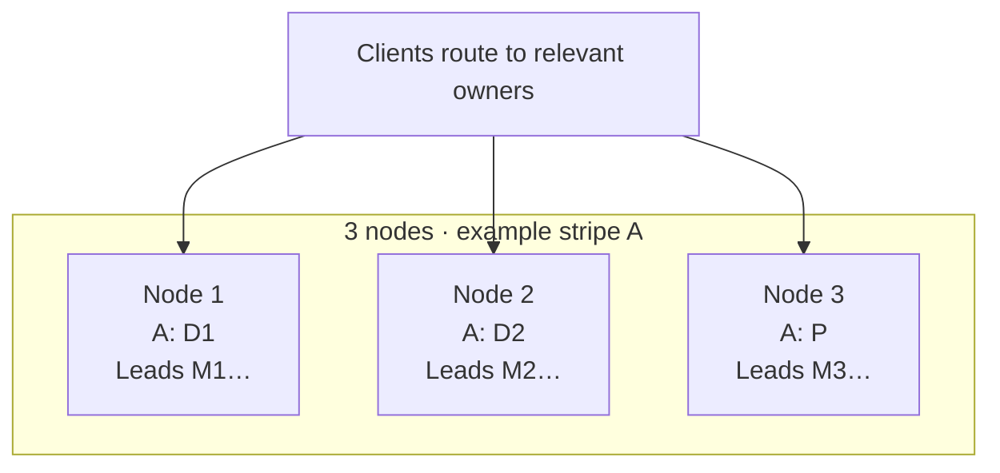
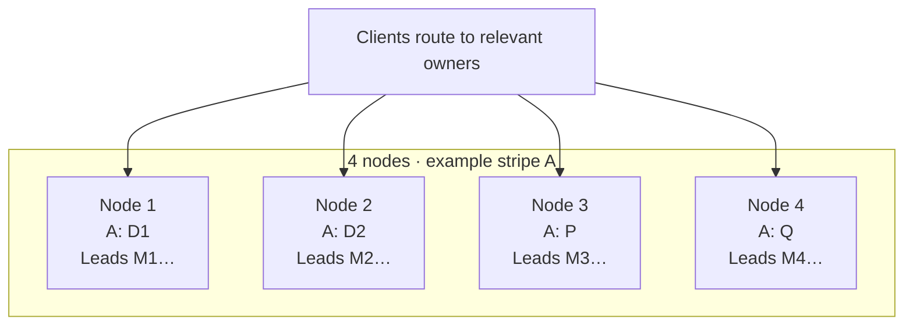
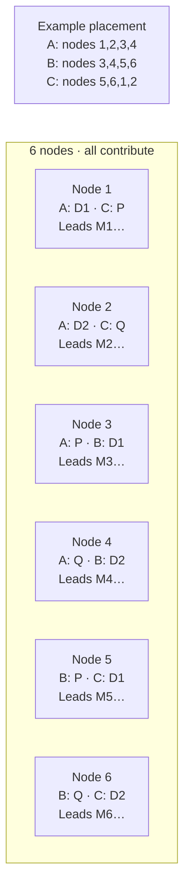
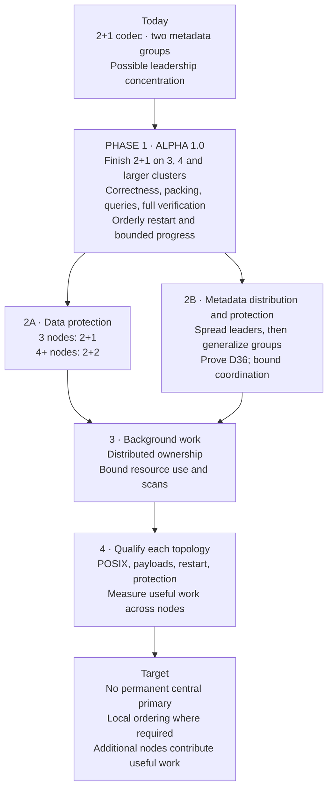

# Distributed EFS — cluster roadmap

October 22, 2026. **Target architecture and implementation roadmap; acceptance
NOTRUN here.** Current-code observations checked on devel `22a2207cd`; no runtime
change or new cluster test is part of this document.

[Status index](README.md) · [D36 protection contract](node-count-protection-20261009.md) ·
[W66 metadata scaling](metadata-scaling.md) ·
[W98 all-node metadata/query service](all-node-metadata-queries-20261009.md)

## Release sequencing — updated October 22

**Phase 1 is now alpha 1.0: finish 2+1 on 3, 4 and >4 nodes.**
The [alpha 1.0 checklist](alpha-1.0-2plus1-checklist.md) is the release gate,
including A6–A12: audit behavior switches, choose built-in policies, remove
competing A/B paths and reduce the combinatorial qualification matrix.
**Metadata placement ladder ([D38](decisions.md), October 22):** alpha 1.0
keeps metadata on at most three nodes (2+1) while data uses every node; alpha
2.0 adds 2+2 metadata across at most four nodes (the D36 four-node protocol);
alpha 3.0 and 4.0 add configurable metadata placement on N − M of N nodes at
one and two losses. The diagrams below describe the final architecture; their
2+2 and many-group targets are later work, not prerequisites for alpha 1.0.
D36 remains binding for the final design; alpha does not claim its two-loss
protection on four or larger clusters.

## Vision and boundaries

No permanent central data or metadata primary. Adding nodes contributes storage,
metadata processing, query service and useful background work. Clients route to
the relevant owners; unrelated operations progress concurrently. Ordering for
one inode or metadata group is necessary for POSIX correctness. It must not
become serialization of the entire cluster.

Distribute ownership while bounding each operation's participant set. Do not
replace a single-node bottleneck with coordination across every cluster node.
Keep related dentry, inode, accounting, session and publication operations local
where possible, with explicit bounded transactions where coordination is needed.

D36 is already accepted: three nodes preserve acknowledged data and authoritative
metadata through any one permanent node loss; four or more preserve them through
any two. Data profiles are **2+1 at three nodes; 2+2 at four or more**. This
roadmap does not reopen or weaken that requirement. The four-node metadata
mechanism and continued availability after losses remain unresolved.

In the diagrams, D1/D2 are data, P/Q independent parity fragments, and M labels
metadata-group leadership. Metadata replicas are omitted for readability: a
leader is never the only authoritative copy. Group counts and placements below
are illustrative targets, not implemented configurations or fixed assignments.

## Three-node target: 2+1

Every node stores fragments and can lead independent metadata groups. Roles
rotate across stripes; these are not dedicated data/parity machines. Current
coding supports 2+1. Current metadata does not provide the illustrated many-group
leadership distribution: there are only two runtime groups.

## Four-node target: 2+2

The fourth node contributes a second independent parity fragment and metadata
and background processing. It is not a standby. Copying the existing XOR parity
fragment is not equivalent to a 2+2 code reconstructible from any two fragments.

**Gap:** `EFS_NUM_FRAGMENTS` is still 3, and the codec describes D1/D2/XOR parity.
Larger clusters do not yet implement the target 2+2 geometry. This change must
cover ordinary chunks, packed segments, placement, wire/store formats, durable
publication evidence, accounting and decode/reclaim paths together.

**Separate metadata obligation:** two surviving fragments do not prove that
metadata or commit identity survives. Four-voter majority Raft needs three votes;
three-voter groups cannot preserve metadata through every two-node-loss pair.
W66 must supply and prove the D36 mechanism. Do not silently introduce a fifth
witness, override quorum, or confuse safe refusal with committed-state preservation.

## Larger-cluster target: 2+2 across four nodes per stripe

Six-node example; each stripe occupies four distinct nodes while placement
rotates over the whole cluster. The annotation below is a placement rule,
not a central routing service.

Successive stripes can use different subsets; a large file can therefore use
many nodes without widening every stripe or metadata transaction. Metadata
groups and leaders must also spread. Ordinary current placement already rotates
three-fragment stripes over available nodes, but that alone does not scale
metadata execution. Packed-object placement has additional group-voter
constraints; ordinary placement is not proof that packing uses every node.

## Current implementation gaps

| Area | Observed implementation | Required direction |
| --- | --- | --- |
| Data codec | `include/efs/common.h`: three fragments; `include/efs/erasure.h`: 2+1 for chunks and segments | W74: 2+1 at 3 nodes, independent 2+2 at 4+; prove durable protection |
| Metadata partitions | `src/server/raft_host.c`: `HOST_NGROUPS 2` | W66: configurable groups mapped across logical shards and nodes |
| Leadership | `host_balanced_voter` prefers a common voter for both groups when applicable | Measure independent leaders first; eliminate dependence on a shared dual-group leader |
| Local execution | Shared host coordination, WAL and KV can serialize work even with multiple groups | Measure blocked time and WAL/apply delay; avoid claiming group count alone fixes contention |
| Namespace locality | Directory policy remains an explicit W66/W81 design item | Bounded hashed placement/lazy slots; prove hot-directory and cross-directory correctness |
| Metadata protection | Four-node D36 protocol remains unproved | Preserve acknowledged authoritative state through every two-node-loss pair; state availability separately |
| Background work | Packing, query building and KV maintenance consume shared CPU/I/O | Ownership-based distribution, bounded passes and measured foreground interference |

Read routing is a separate axis: evaluate the existing follower-read machinery
under its authority rules rather than assume no machinery exists or add unsafe
stale reads. More groups must address routing, snapshots, membership and commit
ownership; changing `HOST_NGROUPS` alone is not an implementation.

## Roadmap and acceptance

| Stage | Work and ownership | Exit evidence |
| --- | --- | --- |
| **1 · alpha 1.0** | **Finish current 2+1 at 3, 4 and >4 nodes**; enabled-path correctness, placement/accounting, packing, queries and orderly lifecycle | [Mandatory checklist and topology matrix](alpha-1.0-2plus1-checklist.md); exact full payloads, bounded progress and explicit limitations |
| 2A | W74/D36 codec, placement and durable protection for both chunks and packing | Exact full payload checks; no duplicate placement within a stripe; durable publication identity and correct accounting; D36 loss matrix |
| 2B | W66/W98/W81 leader distribution, configurable groups, bounded routing and directory policy; D36 metadata mechanism | Independent-directory and hot-directory tests; verified group/slot/leader mappings; metadata loss matrix and safe partition behavior; no common-leader routing dependency |
| 3 | W125 packing, W92/W98 indexing, W124 reclaim and W126 KV maintenance | Bounded progress with foreground correctness; per-node work distribution; no repeated full validation or unbounded prefix rescans; latency/resource evidence |
| 4 | Integrated 3-, 4- and larger-node acceptance | POSIX, concurrent queries, full acknowledged payload verification, orderly cold restart; protection and availability results stated separately; scaling measurements rather than node-count assumptions |

Stages are dependency milestones, not dates or claims that existing features are
unimplemented wholesale. Preserve their current scoped PASS results and open
gates in their owning work items. Small independent background fixes can land
before stage 2; integrated acceptance still needs both data and metadata work.
The [October 22 profile](orcd-tiny-profile-20261022.md) motivates repeated packing
validation and abandonment-scan fixes, but does not measure off-CPU waits or
prove end-to-end scaling gains.

D36 protection acceptance requires all single losses at three nodes and all six
two-loss pairs at four nodes, including acknowledged payloads, namespace,
attributes and durable commit history after permanent storage loss/cold restart.
If unplanned-event testing remains deferred for a release, mark that protection
gate NOTRUN; ordinary-operation acceptance cannot close it by implication.

New format/group layouts use freshly formatted test clusters. No legacy formats,
migration of retained stores, mixed-build support or backward-compatibility matrix
is part of this work. Live expansion/rebalancing of an existing cluster is a
separate feature, not implied by qualification on a larger fresh cluster. This
roadmap makes no cluster change or new data-deletion authorization.
